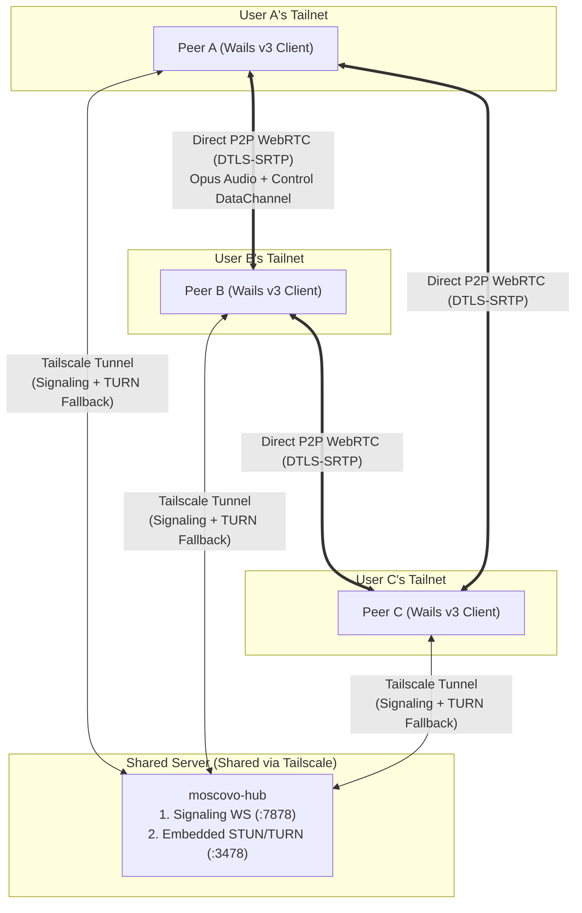

# Moscovo: P2P Audio Communication via Shared Tailscale Hub — Architecture & Implementation Plan

## 1. Overview & Objectives

**Moscovo** is a minimalist desktop voice communication system built with **Wails v3** and **Go** that enables low-latency, peer-to-peer (P2P) audio calls between **2 or more users** across **different Tailnets** who share access to a **single common server via Tailscale Node Sharing** (the **Shared Tailscale Hub**).

This plan is designed for execution by the two specialized personas defined in [`AGENTS.md`](../AGENTS.md):
1. **Go Network Engineer** — Responsible for the pure-Go domain rules (TDD), the lightweight Shared Hub daemon (WebSocket signaling + embedded STUN/TURN relay), the Pion WebRTC mesh engine, context lifecycle, and graceful shutdown.
2. **Minimalist Desktop UI & TUI Specialist** — Responsible for the Wails v3 window configuration, keyboard-first UI, radical simplicity, immediate presence/room clarity, and low-friction voice controls.

### Reference Foundation
Based on [*WebRTC and P2P Communication in Go* (`sazardev/networking-with-go`)](https://sazardev.github.io/networking-with-go/read/advanced-specialized/02-webrtc-and-p2p-communication-in-go.html), this architecture directly implements the chapter's core patterns:
- **The "Mutual Friend" Signaling Server (`cmd/moscovo-hub`):** Because Tailscale Node Sharing is non-transitive (User A on Tailnet 1 and User B on Tailnet 2 can both reach the Shared Server, but cannot reach each other's `100.x.y.z` Tailscale IPs directly), the Shared Server acts as the trusted "Mutual Friend" that introduces peers and coordinates rooms.
- **NAT Traversal with STUN & Fallback TURN:** Clients use ICE (`pion/webrtc/v4`) with STUN (`stun.l.google.com:19302` and/or embedded STUN on the Hub) to discover their public `srflx` endpoints and establish a direct, DTLS-SRTP encrypted UDP flow over the internet (~85% of connections, zero server bandwidth, lowest latency).
- **Guaranteed Connectivity via Hub Relay (`pion/turn`):** For the ~15% of peers behind symmetric NATs or strict firewalls where UDP hole-punching fails, an embedded `pion/turn` relay on the Shared Server (bound to its Tailscale interface) relays the lightweight Opus audio (~48 kbps/peer) over the users' existing Tailscale tunnels.

---

## 2. System Architecture

### 2.1 Topology: Shared Tailscale Hub + Full-Mesh P2P WebRTC

1. **Control & Signaling Plane (Over Tailscale to Shared Hub):**
   - The Shared Server runs `moscovo-hub`, listening exclusively on its Tailscale interface (`<hub-tailscale-ip>:7878`). It is completely invisible to the public internet; only users with whom the Tailscale node was shared can reach it.
   - Desktop clients (`moscovo`) connect to the Hub via WebSocket (`ws://<hub-tailscale-ip>:7878/ws`) to see online peers, join/leave voice rooms, and exchange WebRTC SDP Offers, Answers, and trickle ICE candidates.
2. **Media & Control Data Plane (Direct P2P WebRTC with Hub TURN Fallback):**
   - Once the Hub introduces Peer A and Peer B, their `pion/webrtc` engines perform ICE connectivity checks:
     - **Primary Path (Direct P2P `srflx`/`prflx`):** Direct UDP hole-punched connection between Peer A and Peer B. Avoids WireGuard double-encapsulation and avoids extra geographic hop latency.
     - **Fallback Path (Hub TURN `relay` over Tailscale):** If symmetric NAT blocks direct UDP, media seamlessly falls back to the `pion/turn` listener running on the Shared Hub (`<hub-tailscale-ip>:3478`).



### 2.2 Audio Pipeline & Concurrency Design (KISS & YAGNI)
- **Signaling, Room Roster, and WebRTC Lifecycle** live 100% in Go (`pion/webrtc/v4`).
- **Opus Audio Track & Control DataChannel:**
  - Each `PeerConnection` negotiates a single bidirectional Opus track (`audio/opus`, 48kHz, mono/stereo, 20ms ptime) and an SCTP `DataChannel` (`control`) for real-time mute/deafen states, active speaker indicator, and RTT ping measurement.
- **Decoupled Audio Engine (`internal/audio/`):**
  - Domain and WebRTC transport code interact with a narrow `AudioIO` interface (`ReadMicSample`, `WritePeerSample`) so unit and integration tests run deterministically in pure Go without audio hardware.

---

## 3. Directory Structure

```text
Moscovo/
├── AGENTS.md
├── plans/
│   └── 01-architecture-and-implementation-plan.md
├── go.mod
├── cmd/
│   ├── moscovo-hub/              # SHARED SERVER DAEMON (headless binary for the Shared Tailscale Server)
│   │   └── main.go               # Starts WS signaling server + embedded pion/turn relay on Tailscale IP
│   └── moscovo/                  # WAILS v3 DESKTOP CLIENT
│       └── main.go               # Wails v3 application entry point & graceful shutdown wiring
├── internal/
│   ├── domain/                   # PURE DOMAIN (100% TDD, zero network/hardware I/O)
│   │   ├── peer.go               # Peer identity, state machine (Idle, Signaling, Connecting, Connected)
│   │   ├── peer_test.go
│   │   ├── room.go               # Hub & Client room roster invariants, mesh diffing, glare tie-breaking
│   │   ├── room_test.go
│   │   ├── signal.go             # Signaling protocol envelopes (Join, Roster, Offer, Answer, ICE, Leave)
│   │   └── signal_test.go
│   ├── hub/                      # SHARED SERVER TRANSPORT (Go Network Engineer)
│   │   ├── server.go             # Context-bounded HTTP/WS signaling hub & room broadcaster
│   │   └── turn.go               # Embedded pion/turn STUN/TURN server bound to Tailscale interface
│   ├── transport/                # CLIENT NETWORK I/O (Go Network Engineer)
│   │   ├── hub_client.go         # Reconnecting WS client to the Shared Hub with heartbeat & timeouts
│   │   └── webrtc_mesh.go        # Pion WebRTC PeerConnection pool, STUN/TURN config, Track & DataChannel
│   ├── audio/                    # CLIENT AUDIO I/O WRAPPER
│   │   └── engine.go             # Microphone capture, Opus encode/decode, per-peer mixer
│   └── app/                      # WAILS v3 SERVICE BINDINGS
│       └── voice_service.go      # Concise frontend bindings & Wails v3 event emitter
└── frontend/                     # MINIMALIST UI (Minimalist Desktop UI & TUI Specialist)
    ├── index.html
    └── src/
        ├── main.ts               # Keyboard navigation, state store, Wails v3 event listeners
        └── style.css             # High-contrast, compact, zero-clutter layout
```

---

## 4. Work Breakdown by Agent Persona

### Role 1: Go Network Engineer

#### Core Responsibilities
1. **Pure Domain Layer (`internal/domain/`) — Strictly TDD First:**
   - **Signaling Protocol & Envelope Validation (`signal.go`):**
     - Message types: `join`, `leave`, `roster`, `offer`, `answer`, `candidate`, `error`.
     - Validate sender/target Peer IDs, non-empty SDP payloads, and ephemeral TURN credential formatting.
   - **Room & Mesh Coordination Rules (`room.go`):**
     - Deterministic **Initiator / Polite Peer Rule**: When a new peer joins the room on the Hub, the Hub broadcasts the updated `roster`. To prevent SDP "glare" (two peers sending Offers simultaneously), enforce a deterministic rule: `peerA.ID < peerB.ID` always initiates the Offer; the higher ID waits and answers.
     - Compute mesh diffs (which new `PeerConnection`s to spawn and which stale ones to close when a `roster` update arrives).
   - **Peer State Machine (`peer.go`):**
     - Enforce valid state transitions (`Connecting` -> `DirectP2P` | `RelayedTURN` -> `Disconnected`) and track whether the active ICE candidate pair is direct (`srflx`/`host`) or relayed (`relay`).
2. **Shared Tailscale Hub Daemon (`internal/hub/` & `cmd/moscovo-hub/`):**
   - **Signaling Server (`server.go`):** Lightweight HTTP/WebSocket server bound to `<hub-tailscale-ip>:7878`. Maintains active room presence in memory, routes targeted `offer`/`answer`/`candidate` messages between `PeerID`s, and immediately broadcasts `leave` when a client's WebSocket closes or fails its ping deadline.
   - **Embedded STUN/TURN Relay (`turn.go`):** Using `github.com/pion/turn/v4`, bind a UDP/TCP STUN+TURN listener on `<hub-tailscale-ip>:3478`. Issue short-lived, HMAC-signed credentials to clients upon WebSocket `join` so symmetric-NAT peers can always relay audio through the Hub over Tailscale.
3. **Client Signaling & Pion WebRTC Engine (`internal/transport/`):**
   - **Hub Client (`hub_client.go`):** Context-bounded WebSocket client to the Shared Server with automatic exponential backoff reconnection and 10s ping/pong liveness checks.
   - **WebRTC Mesh Manager (`webrtc_mesh.go`):**
     - Configure `webrtc.Configuration` with `ICEServers`:
       1. `stun:stun.l.google.com:19302` + `stun:<hub-tailscale-ip>:3478` (for direct P2P hole punching).
       2. `turn:<hub-tailscale-ip>:3478` (for guaranteed fallback relay over Tailscale).
     - Exclude virtual/tunnel interfaces (`tailscale0`, `docker0`) from **direct** peer-to-peer `host` candidates (since peers are on different Tailnets and cannot reach each other's `100.x.y.z` directly), while keeping physical interfaces for STUN `srflx` and the Tailscale interface for reaching the Hub's TURN server.
     - Manage outgoing Opus `TrackLocalStaticSample` and incoming `OnTrack` streams plus the `control` `DataChannel`.
     - Inspect selected ICE candidate pair (`GetStats` / `OnSelectedCandidatePairChange`) to report to the UI whether each peer link is `P2P` (direct UDP) or `RELAY` (via Shared Hub).
4. **Bounded Lifecycles & Graceful Shutdown:**
   - Every dial, WebSocket write, and ICE gathering step must use `context.Context` deadlines.
   - Closing the app or leaving a room sends a polite `leave` frame (bounded by a 500ms timeout), closes all `DataChannel`s and `PeerConnection`s, stops audio goroutines, and waits on `sync.WaitGroup`.

---

### Role 2: Minimalist Desktop UI & TUI Specialist

#### Core Responsibilities
1. **Wails v3 Window & Layout:**
   - Compact default window (`360x480`, minimum `280x320`), dark high-contrast theme, zero window chrome clutter, resilient to tiling window managers (Hyprland/Sway/i3).
2. **Radical Simplicity (Single-Screen Experience):**
   - **Zero modals, zero tabs, zero avatars, zero text-chat clutter.**
   - Having a Shared Hub makes the UI even simpler than direct IP dialing: as soon as the app opens, it connects to the Hub and shows who is in the voice room.
   - Three compact visual regions:
     1. **Hub Status Header (1 line):** Shared Hub address (`hub.tailnet:7878` or `100.x.y.z`), editable inline on click/`/`, plus connection badge (`ONLINE` | `IN CALL` | `RECONNECTING`).
     2. **Room / Peer List (Main area):**
        - Displays all peers currently in the Hub's voice room.
        - Each peer row shows: Speaking indicator (`◉` / `○`), Display Name, Connection Path badge (`P2P` for direct hole-punched UDP or `TURN` for Hub-relayed), RTT latency (`ms`), and local volume/mute status.
     3. **Action & Shortcut Bar (Footer):**
        - `[Enter/Space] Join / Leave Call`, `[M] Mic`, `[D] Deafen`.
3. **Keyboard-First Workflow:**
   - `Enter` — Join or Leave the voice room on the Shared Hub (1-keystroke call entry).
   - `m` — Toggle microphone mute.
   - `d` — Toggle output deafen.
   - `Space` (hold) — Push-to-Talk when muted.
   - `j` / `k` (or `Up` / `Down`) — Select a peer in the list; `h` / `l` (or `-` / `+`) — Adjust that peer's local volume; `x` — Mute selected peer locally.
   - `/` — Edit Shared Hub address & nickname.
   - `Esc` / `Ctrl+Q` — Leave call / quit application cleanly.

```text
┌────────────────────────────────────────────┐
│ ● hub: 100.64.10.1:7878   [IN CALL • 3/3]  │
├────────────────────────────────────────────┤
│ VOICE ROOM                                 │
│ ◉ you (df-linux)                  MIC: ON  │
│ ◉ alice            [P2P]   18ms   100%     │
│ ○ bob              [TURN]  42ms   100% 🔇  │
├────────────────────────────────────────────┤
│ [M] MUTE     [D] DEAFEN     [ESC] LEAVE    │
└────────────────────────────────────────────┘
```

---

## 5. Step-by-Step Implementation Phases

### Phase 1: Project Scaffolding & Pure Domain Rules (TDD)
- **Owner:** Go Network Engineer
- **Tasks:**
  1. Initialize Go module (`go mod init moscovo`) and package layout (`cmd/moscovo-hub`, `cmd/moscovo`, `internal/...`).
  2. Write failing table-driven tests in `internal/domain/`:
     - Signaling message validation (`join`, `roster`, `offer`, `answer`, `candidate`, `leave`).
     - Room membership invariants on the Hub (adding/removing peers, rejecting duplicate IDs).
     - Client mesh diffing and deterministic Offer initiator rule (`localID < remoteID` sends Offer; otherwise waits for Offer) to eliminate signaling glare in 3+ user rooms.
     - Peer connection state transitions (`Signaling` -> `ConnectedP2P` / `ConnectedRelay` -> `Closed`).
  3. Implement `internal/domain/` until `go test -v -race ./internal/domain/...` passes.

### Phase 2: Shared Tailscale Hub (`cmd/moscovo-hub`)
- **Owner:** Go Network Engineer
- **Tasks:**
  1. Implement `internal/hub/server.go`:
     - WebSocket endpoint (`/ws`) with strict read/write timeouts and ping/pong keepalives.
     - Room coordinator that broadcasts `roster` updates and routes `offer`/`answer`/`candidate` envelopes between connected peers.
  2. Implement `internal/hub/turn.go`:
     - Embedded `pion/turn/v4` server bound to the Hub's Tailscale IP (`:3478`).
     - Dynamic ephemeral credential generator sent to clients in the `roster` welcome payload.
  3. Build `cmd/moscovo-hub/main.go` with auto-detection of the server's `tailscale0` IP (or `-listen` flag) and graceful `SIGINT`/`SIGTERM` shutdown.

### Phase 3: Client WebRTC Mesh & Audio Engine (`internal/transport` & `internal/audio`)
- **Owner:** Go Network Engineer
- **Tasks:**
  1. Implement `internal/transport/hub_client.go` to maintain a resilient WebSocket connection from the Wails client to the Shared Hub over Tailscale.
  2. Implement `internal/transport/webrtc_mesh.go` following the `sazardev` Pion WebRTC lifecycle:
     - Configure STUN (public + Hub STUN) and TURN (Hub TURN over Tailscale).
     - Manage per-peer `webrtc.PeerConnection`, Opus `TrackLocalStaticSample`, `OnTrack` reader, and `control` `DataChannel` (broadcasting mute state, speaking indicator, and RTT pings).
     - Detect whether each peer connection resolved to a direct P2P candidate (`srflx`/`prflx`) or Hub relay (`relay`) and surface that telemetry to the UI.
  3. Implement `internal/audio/engine.go` for low-latency microphone capture, Opus encoding/decoding, and per-peer audio mixing.

### Phase 4: Minimalist Wails v3 Desktop UI (`frontend/` & `internal/app`)
- **Owner:** Minimalist Desktop UI & TUI Specialist
- **Tasks:**
  1. Implement `internal/app/voice_service.go` exposing concise Wails v3 bindings (`SetHubConfig`, `JoinCall`, `LeaveCall`, `ToggleMute`, `ToggleDeafen`, `SetPeerVolume`) and emitting state events (`hub:state`, `room:roster`, `peer:stats`).
  2. Build the single-window UI in `frontend/`:
     - Clean, dependency-free CSS layout with immediate visual hierarchy for active speakers, connection mode (`[P2P]` vs `[TURN]`), and latency (`ms`).
     - Full keyboard navigation (`Enter`, `M`, `D`, `Space`, `j`/`k`, `h`/`l`, `/`, `Esc`) and non-blocking inline error notifications.

### Phase 5: End-to-End Verification & Shutdown Audit
- **Owners:** Go Network Engineer & Minimalist Desktop UI & TUI Specialist
- **Tasks:**
  1. Verify 2-peer and 3+ peer voice calls through `moscovo-hub`, confirming both direct P2P (`srflx` UDP hole punching) and forced TURN relay mode (`relay` over the Shared Hub's Tailscale IP).
  2. Verify abrupt peer disconnect recovery and Hub restart auto-reconnection.
  3. Run `go test -race ./...` and verify zero goroutine or socket leaks on room leave and app exit.

---

## 6. Acceptance Criteria Checklist

- [ ] **Domain TDD:** All room roster rules, Offer/Answer initiator tie-breaking, and signaling validations in `internal/domain` have failing tests written first and pass `go test -race`.
- [ ] **Cross-Tailnet Reachability via Shared Hub:** Peers on separate Tailnets can discover each other and exchange signaling exclusively through the shared `moscovo-hub` node (`<hub-tailscale-ip>:7878`).
- [ ] **Optimal P2P with Guaranteed Relay Fallback:** Clients prioritize direct STUN hole-punched P2P (`[P2P]`) for minimum latency and zero server bandwidth, and seamlessly fall back to the Hub's embedded TURN server (`[TURN]`) when behind symmetric NATs.
- [ ] **2+ User Mesh Scaling:** When a 3rd+ peer joins the room on the Hub, all peers automatically establish direct WebRTC audio and control channels with zero SDP glare.
- [ ] **Leak-Free Concurrency:** All network I/O is bounded by `context.Context`, and shutting down the client or Hub cleanly closes all WebSockets, `DataChannel`s, `PeerConnection`s, and goroutines.
- [ ] **Radical UI Simplicity:** Single-screen Wails v3 interface with 1-key Join/Leave (`Enter`), full keyboard shortcuts, clear `[P2P]`/`[TURN]` and RTT indicators, and zero modals or visual clutter.
