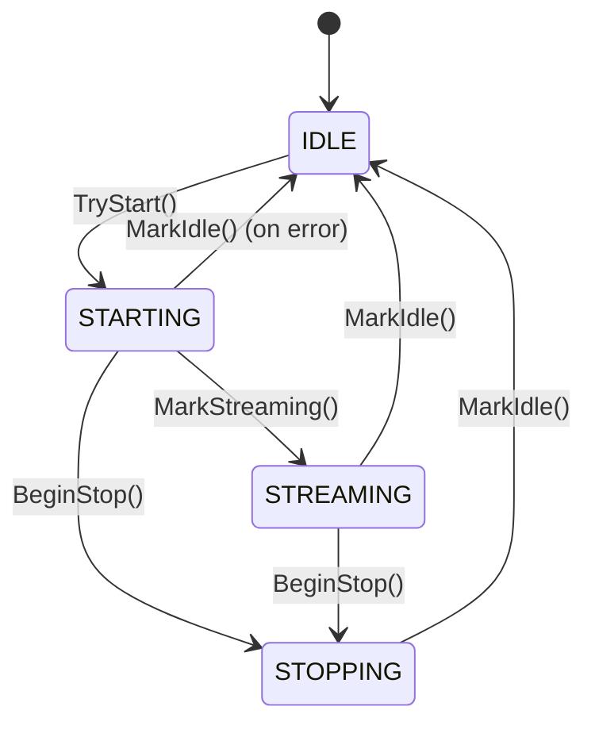

# Moscovo: Native Backend-Driven Screen Sharing — Architecture & Implementation Plan

## 1. Overview & Objectives

This document describes the integration of native, backend-driven screen sharing into **Moscovo** (**Wails v3** + **Go** + **Pion WebRTC v4**) targeting **Windows** and **Linux (X11 and Wayland)** while maintaining voice call continuity and radical UI simplicity.

By moving source discovery, screen/window capture, desktop loopback audio capture, and encoding into the Go backend, Moscovo avoids WebView `getDisplayMedia()` restrictions on Linux WebKitGTK, supports `org.freedesktop.portal.ScreenCast` on Wayland, provides a custom source-picker UI, and isolates system loopback audio from the microphone noise-suppression pipeline.

---

## 2. Module Architecture

```text
internal/
├── domain/
│   ├── peer.go                      # Extended PeerSession (ScreenSharing, ScreenAudio)
│   ├── screenshare.go               # Pure domain rules: lifecycle state machine, config, scaling, bitrate math
│   └── screenshare_test.go          # TDD unit & concurrency tests
├── screenshare/
│   ├── encoder/
│   │   ├── pool.go                  # sync.Pool for image.RGBA & YUV420p planes + BT.601 color conversion + JPEG helpers
│   │   ├── video_encoder.go         # VideoEncoder interface (FFmpeg HW/SW + low-latency VP8 bitstream encoder)
│   │   ├── audio_encoder.go         # SystemAudioEncoder for 48kHz Opus loopback frames (isolated from mic)
│   │   └── encoder_test.go
│   └── capture/
│       ├── capture.go               # Capturer interface, thumbnail helpers, CaptureConfig
│       ├── pipeline.go              # Single-slot drop-frame capture->YUV->encode pipeline + adaptive bitrate
│       ├── portal_linux.go          # Wayland org.freedesktop.portal.ScreenCast D-Bus + PipeWire ingestion
│       ├── capture_linux.go         # X11 monitor/window discovery & capture + PulseAudio/PipeWire monitor loopback
│       ├── capture_windows.go       # Windows DXGI Desktop Duplication / GDI fallback + WASAPI loopback (no CGO)
│       ├── capture_other.go         # Stub for unsupported OS targets
│       └── capture_test.go
├── transport/
│   └── webrtc_mesh.go               # Dynamic TrackLocalStaticSample injection, SDP renegotiation, RTCP feedback, viewer bridge
└── app/
    ├── voice_service.go             # Wails bindings (GetShareableSources, Start/StopScreenShare, NegotiateScreenViewer)
    └── voice_service_test.go
```

---

## 3. Lifecycle State Machine & Concurrency Safety (NFR-06)

`domain.ScreenShareLifecycle` guards transitions with a mutex so rapid UI/hotkey toggles never race:



---

## 4. Platform Capture Pipelines (FR-01, FR-02, FR-06, NFR-05)

### 4.1 Windows (`//go:build windows`, Pure Syscall / `NewLazyDLL`)
- **Source Discovery:** `EnumDisplayMonitors` + `GetMonitorInfoW` for monitors; `EnumWindows` + `IsWindowVisible` + `GetWindowTextW` + `DwmGetWindowAttribute(DWMWA_CLOAKED)` for visible windows. Thumbnails rendered via `BitBlt`/`PrintWindow` + `GetDIBits` and JPEG-encoded.
- **Screen Capture:** DXGI Desktop Duplication (`d3d11.dll`, `dxgi.dll`) for monitor capture with automatic GDI fallback (`gdi32.dll` / `user32.dll` `PrintWindow`/`BitBlt`) for application windows or environments without DXGI duplication.
- **Loopback Audio:** WASAPI Loopback (`ole32.dll` COM `IMMDeviceEnumerator` -> `IAudioClient` with `AUDCLNT_STREAMFLAGS_LOOPBACK` -> `IAudioCaptureClient`) producing 20ms 48kHz PCM frames isolated from `internal/audio`.

### 4.2 Linux X11 (`//go:build linux`)
- **Source Discovery:** `xrandr --listmonitors` (plus X11 root fallback) for screens; pure-Go X11 wire protocol over `/tmp/.X11-unix/X<d>` (`_NET_CLIENT_LIST`, `_NET_WM_NAME`/`WM_NAME`, `GetGeometry`) for mapped visible windows, with JPEG thumbnails via `ffmpeg -f x11grab` or clean placeholder fallback.
- **Screen Capture:** `ffmpeg -f x11grab` / `gst-launch-1.0 ximagesrc` targeting the selected monitor geometry or X11 window ID, monitoring window existence so window closure stops capture cleanly (`FR-05`).
- **Loopback Audio:** Default sink monitor (`<sink>.monitor` via `pactl`/`wpctl`) captured at 48kHz stereo via `parec`.

### 4.3 Linux Wayland (`//go:build linux`, `XDG_SESSION_TYPE=wayland`)
- **Portal Negotiation:** `github.com/godbus/dbus/v5` connects to the session bus and runs `org.freedesktop.portal.ScreenCast`:
  1. `CreateSession` -> `Request.Response`
  2. `SelectSources` (Monitor `1` | Window `2`, cursor mode `2`)
  3. `Start` -> extracts PipeWire `node_id` and stream geometry
  4. `OpenPipeWireRemote` -> passes PipeWire FD to `gst-launch-1.0 pipewiresrc fd=<fd> path=<node_id>` (with `grim` fallback on wlroots compositors when available).
- **Revocation Detection:** Subscribes to `org.freedesktop.portal.Session.Closed` so portal permission revocation stops the pipeline and emits `screenshare:stopped`.

---

## 5. Encoding, Bitrate Adaptation & Memory Pools (NFR-01..NFR-04)

- **Buffer Reuse:** `encoder.FramePool` pools `*image.RGBA` and `*encoder.YUV420Buffer` planes via `sync.Pool` across capture, scaling, conversion, and encoding.
- **Drop-Frame Pacing:** `capture.Pipeline` uses a single-slot frame handoff (`select` overwrite) so slow encoders or network backpressure drop stale frames rather than queuing latency (> 100ms).
- **Dynamic Bitrate:** RTCP REMB (`ReceiverEstimatedMaximumBitrate`), `ReceiverReport` loss fraction, and RTT feed `domain.ComputeAdaptiveBitrate` clamped between `500 kbps` and `4 Mbps`. PLI/FIR RTCP feedback triggers immediate keyframe emission.
- **Audio Isolation:** `screenshare-audio` sends 20ms Opus frames on its own `TrackLocalStaticSample`, completely separate from `audio.Engine` and the frontend RNNoise AudioWorklet.

---

## 6. WebRTC Renegotiation & Frontend Viewer Bridge (FR-04, FR-05)

1. `WebRTCMesh.StartScreenShareTracks` adds `screenshare-video` (and optional `screenshare-audio`) tracks to every active `PeerConnection`, starts an RTCP reader loop per video `RTPSender`, and sends a glare-safe renegotiation SDP Offer to each peer.
2. Receiving peers handle renegotiation offers in `handleOffer` (including polite rollback if non-stable), receive remote tracks in `pc.OnTrack`, update `PeerSession.ScreenSharing`, and forward incoming video to:
   - Local loopback `viewerPC` (`NegotiateScreenViewer`) so the Wails frontend renders via native WebRTC `<video>` `pc.ontrack`.
   - `screenshare:frame` Wails events (`<canvas>` fallback) for WebViews lacking WebRTC video codec playback.
3. `StopScreenShareTracks` removes the tracks via `pc.RemoveTrack`, renegotiates SDP without disrupting the voice call, closes OS handles, and emits `screenshare:stopped`.

---

## 7. Verification Plan

1. `go test -v -race ./internal/domain/... ./internal/screenshare/... ./internal/audio/... ./internal/app/...`
2. `go test -v -race ./internal/transport/...`
3. `go build -o bin/moscovo-hub ./cmd/moscovo-hub && go build -tags gtk3 -o bin/moscovo ./cmd/moscovo`
4. `GOOS=windows GOARCH=amd64 go build -o bin/moscovo-hub.exe ./cmd/moscovo-hub && GOOS=windows GOARCH=amd64 go build -o bin/moscovo.exe ./cmd/moscovo`
